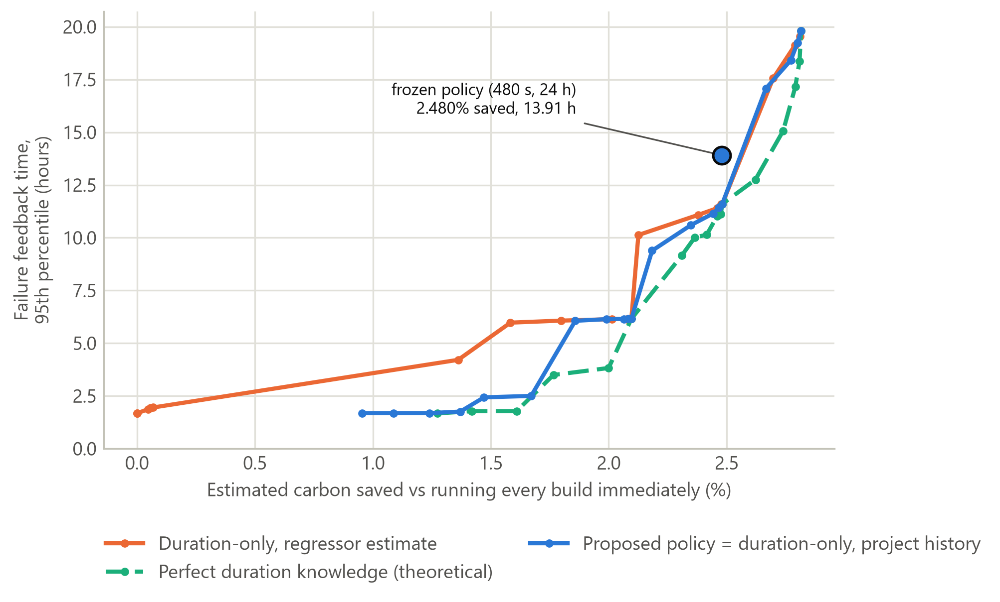
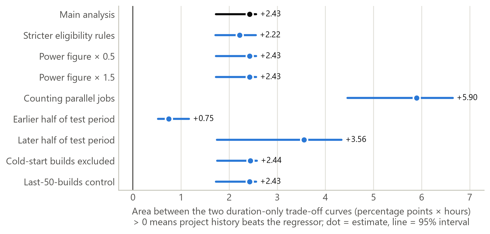

# Chapter 5 — Evaluation

> **Drafting notes (delete before submission).** Every number here comes from a project result file;
> the sources are listed at the end of the chapter. Prototype results (Section 5.4.7, Tables 5.8 and
> 5.9) come from `results/p4/` and are demonstration evidence, not research evidence. Sections 5.7
> (User Evaluation) and 5.8 (Usability Evaluation) are left out on purpose, because no user study was
> carried out. Chapter 6 (Discussion) is in `chapter6_discussion.md`.

---

## 5.1 Evaluation Parameters

This chapter asks one main question: **when deciding which CI builds to delay to a cleaner hour of the
electricity grid, do the characteristics of a commit help beyond a simple estimate of how long the
build will take?** It also measures how well the resulting policy compares with the usual ways of
running CI.

The evaluation was designed so that the results could not be tuned after the fact. The policy was
built using the training and calibration projects only. The metrics, the comparison points and the
thresholds for a "meaningful" improvement were all fixed before the test projects were opened.

**Table 5.1 — Evaluation parameters**

| Parameter | Setting |
| :-- | :-- |
| Test data | 138,693 builds from 170 projects that were never used to build the model or the policy (Travis CI, April 2011 – August 2016; 25.04% of builds failed) |
| Method | Historical replay: every test build is replayed in time order through each scheduling strategy, on exactly the same builds |
| Policy tested | The frozen policy: a build that is allowed to wait is delayed only if it is expected to take at least **8 minutes (480 s)**, to the cleanest hour within the next **24 hours** |
| Carbon data | Great Britain's grid, 2024–2025, averaged for each of the 168 hours of the week (92.24 to 172.91 gCO₂/kWh) |
| Energy model | Energy = 42.5 W × build duration; carbon = energy × grid intensity at the hour the build runs. All carbon figures are **estimates** |
| Settings tested | 102 strategy settings: delay windows of 6, 12 or 24 hours (167 hours for blanket delay) combined with ten duration thresholds, plus seven skip thresholds and the immediate baseline. In total, 14,146,686 replayed decisions |
| Uncertainty | 95% confidence intervals from a paired bootstrap with 1,000 resamples |
| What counts as meaningful (fixed in advance) | A group of commit characteristics must raise PR-AUC by at least 0.01. At the decision level, it must give at least 5% faster failure feedback, or a 1% relative increase in carbon saved, at three or more comparable points. Every check is repeated at half and at double these thresholds |

**A correction made during the evaluation.** After the first test run, a review found a flaw in the
duration estimate. It counted earlier builds that had started but **not yet finished**, which a real
CI system could not know. The rules for the fix were written down before any new result existed. The
whole analysis was then re-run, which meant opening the test data a second time. The fix touched
27.41% of test builds (38,019 of 138,693), but the median change in an affected build's duration
estimate was 0.00% (95th percentile 0.84%), and **none of the research answers changed.** All
results below are the corrected ones.

---

## 5.2 Framework Components

The evaluation looks at six things:

1. **Accuracy.** How well the duration estimate and the failure-prediction models work on projects
   they have never seen.
2. **Value of commit characteristics.** The core of this research: whether each group of commit
   characteristics adds anything beyond the duration estimate, first in prediction and then in actual
   scheduling decisions.
3. **Scheduling effectiveness.** How much carbon each strategy saves, and how much it delays developer
   feedback.
4. **Robustness.** Whether the conclusions still hold when the assumptions change.
5. **Functionality and correctness.** Whether the system follows its own rules: it never delays a
   build that must run now, never uses information it should not have, and gives the same result every
   time.
6. **Performance.** How long the pipeline takes to run, and how quickly the prototype responds.

---

## 5.3 Evaluation Criteria

**Table 5.2 — Evaluation criteria and measurements**

| Component | Criteria | Measurements |
| :-- | :-- | :-- |
| Accuracy: duration estimate | Ranks builds by length well enough to apply a threshold | Average and median error; rank correlation with the real duration |
| Accuracy: failure models | Separates failing builds from passing ones, with trustworthy probabilities | PR-AUC (main measure, because failures are the minority), ROC-AUC, calibration error, precision, recall, F1 |
| Value of commit characteristics | Must clear the thresholds fixed in advance | Gain in PR-AUC with a confidence interval; difference between the carbon-versus-feedback curves of the proposed policy and the duration-only strategy |
| Scheduling effectiveness | Saves carbon without unacceptable delay | Estimated carbon per 1,000 builds; share of builds delayed; average added delay; **failure feedback time**, the time until a failing build reports its result (typical value and 95th percentile) |
| Robustness | Conclusions survive the planned changes in assumptions | Whether each conclusion stays the same or changes |
| Functionality and correctness | Safe, leak-free, repeatable | Builds that must run now but were delayed (target zero); automated tests; identical results on re-runs |
| Performance | Runs on one laptop; prototype answers early in a CI job | Runtime of each stage; time from the Action's first step to the recorded decision |
| Prototype | Gives a correct, explained recommendation and fails safely | Agreement between the command-line tool, the REST API and the research decision function; fail-safe cases; real CI runs on a demonstration repository; What-If reports |

---

## 5.4 Experimental / Test Results

### 5.4.1 Functional and correctness testing

The system was checked against its own rules before any result was trusted.

**Table 5.3 — Functional and correctness results**

| Check | Result |
| :-- | :-- |
| Automated tests | 645 passed at the end of the evaluation; 807 after the prototype was added |
| Builds that must run now but were delayed, checked by an independent checker | **0** out of 1,015,974 delays (14,146,686 decisions, across all settings) |
| Builds that must run now but were skipped | **0** out of 39,453 skips (across all skip settings) |
| Eligibility rules compared with a separately written checker | No disagreement across 55,228 different combinations of pull-request flag and branch |
| Every strategy saw exactly the same builds | Yes |
| Policy rebuilt from scratch | Identical file, byte for byte |
| Use of a build's real duration or outcome in its own decision | Refused by design: the decision function rejects any build that carries its duration or outcome. A unit test that scrambles durations and flips outcomes changes no decision |

These checks prove the system obeys its rules consistently. They cannot prove the eligibility rules
are *right*: the data has no record of which builds were truly urgent.

### 5.4.2 How accurate is the duration estimate?

Two ways of estimating duration were compared. The **project-history** estimate uses the median
duration of the same project's earlier, finished builds. The **commit-characteristic regressor**
predicts duration from the commit's characteristics.

**Table 5.4 — Duration estimate on the test projects**

| Method | Average error (log scale) | Average error | Median error | Rank correlation |
| :-- | --: | --: | --: | --: |
| **Project history (used by the policy)** | **0.5727** | **808.3 s** | **183.0 s** | **0.8195** |
| Commit-characteristic regressor | 0.9868 | 1,532.1 s | 373.9 s | 0.5128 |
| Project history, last 50 builds only (extra check) | 0.3128 | — | — | 0.9000 |

The project-history method, chosen in advance, stays clearly better on unseen projects. Using only
the last 50 builds is more accurate still. This is reported as a finding, but the policy was not
switched to it after seeing the results.

### 5.4.3 Do commit characteristics improve prediction?

Each group of commit characteristics was added, one at a time, to a model that already had the
duration estimate. The question was whether it predicted failures better.

**Table 5.5 — Gain in PR-AUC from each group of characteristics (test projects)**

| Group of characteristics | Gain [95% CI] | Meaningful? |
| :-- | :-- | :-- |
| Change size and spread | **+0.013** [+0.012, +0.015] | Only at the normal and half thresholds, not at double |
| Change purpose and file mix | −0.002 [−0.003, −0.001] | No, slightly worse |
| Test activity and maturity | −0.033 [−0.035, −0.030] | No, worse |
| Project history and maturity | −0.010 [−0.012, −0.007] | No, worse |
| Developer and team | −0.005 [−0.008, −0.003] | No, worse |
| Timing and trigger | +0.003 [+0.001, +0.004] | No, too small |
| All 28 characteristics together | −0.022 [−0.024, −0.019] | No, worse for all three algorithms |

- **No group passed on the calibration data**, so the policy was frozen as duration-only.
- **Change size is the only group that looks positive on the test data, and the evidence is weak:**
  - on the calibration data it made predictions *worse* (−0.003);
  - it fails at double the threshold;
  - it drops below the threshold in the later half of the test period (+0.009).

  So it is reported as **unresolved**, not as a useful signal.
- **"Important" is not the same as "useful".** The feature-importance method (SHAP) ranked project
  history and test activity as the most influential groups, yet both made predictions worse when
  added.

### 5.4.4 Do commit characteristics improve scheduling decisions?

This is the main test. For each strategy, the carbon saved was plotted against the failure feedback
time across all its settings. The resulting curves were then compared at matching points. The gap is
the area between two curves, measured in percentage points of carbon saved × hours of feedback time.
A positive gap means the first strategy gives faster feedback for the same carbon saving.

**Table 5.6 — Comparing the decision curves (test projects)**

| Comparison | Gap between curves, pp × h [95% CI] | Meaningful? |
| :-- | :-- | :-- |
| Proposed policy vs duration-only (project history) | **0.0000** [0.0000, 0.0000] | **No, at every threshold** |
| Duration-only: project history vs regressor | +2.43 [+1.73, +2.56] | Yes, at every threshold |
| Perfect knowledge of duration (theoretical) vs project history | +1.93 [+1.77, +2.35] | Yes (a bound, not a usable strategy) |
| Last-50-builds estimate vs project history (extra check) | +0.36 [+0.24, +0.78] | Yes, at the normal and half thresholds |

Because no group of characteristics was admitted, the proposed policy **is** the duration-only
policy, so their curves are identical. This is an honest "no" built into a pipeline that was fixed in
advance. It is not a separate head-to-head contest. The table also shows where real gains lie: **a
better duration estimate improves decisions; commit characteristics did not.**

Figure 5.1 draws each curve through the best settings of each strategy. The frozen policy (480 s,
24 h) sits slightly above its own curve. On the test projects, another setting of the same strategy
(no duration threshold, 12-hour window) reached the same saving (2.481% against 2.480%) with faster
failure feedback (11.60 h against 13.91 h at the 95th percentile). It did so by delaying 18.10% of
builds rather than 7.92%. The frozen point was chosen on calibration data before the test projects
were opened. Re-choosing it now would be after-the-fact tuning, so the frozen policy is reported as
it stands.

**Figure 5.1 — Carbon saved vs failure feedback time for the duration-only strategies (test projects)**

### 5.4.5 How well does the policy schedule builds?

**Table 5.7 — The strategies at their chosen settings (test projects)**

| Strategy | Builds delayed | Est. carbon change vs running immediately | Avg. added delay (all builds) | Failure feedback, 95th percentile |
| :-- | --: | --: | --: | --: |
| Run immediately (today's CI) | 0% | — (2,849.6 g per 1,000 builds) | 0 h | 1.67 h |
| Delay everything that may wait, up to a week | 19.44% | −4.681% | 17.48 h | 127.01 h |
| Delay everything that may wait, up to 24 h | 18.74% | −2.815% | 2.44 h | 19.81 h |
| Duration-only, regressor estimate | 9.42% | −2.411% | 1.21 h | 14.07 h |
| **Proposed policy** (= duration-only, project history) | **7.92%** | **−2.480%** | **1.02 h** | **13.91 h** |

What this means:
- **Against today's CI**, the proposed policy saves an estimated 70.7 g of CO₂e per 1,000 builds
  (95% CI 64.9–78.5), or 2.480%. It delays fewer than 1 in 12 builds, by at most a day.
- **Against "delay everything up to a week"**, that approach saves almost twice the carbon (4.681%).
  But the slowest 5% of failing builds then take over five days to report back (127.01 h, against
  13.91 h).
- **Against "delay everything up to 24 h"**, the policy uses 9.6 g more carbon per 1,000 builds. In
  return it reports failures 5.91 h sooner at the 95th percentile.
- **Among running immediately, the proposed policy and the two blanket strategies, none wins on both
  carbon and speed.** Each step towards more carbon saving costs developer feedback time. Against the
  regressor-based duration strategy, the policy uses 2.0 g less carbon per 1,000 builds (95% CI
  1.5–2.4), with no significant difference in failure feedback (−0.16 h [−0.61, +0.18]).
- **Why the saving is modest.** Of the 138,693 test builds:
  - 111,666 must run immediately;
  - 15,675 are expected to be too short to be worth delaying;
  - 369 have no cleaner hour available;
  - only 10,983 are actually delayed.

  The British grid's dirtiest hour is also only 1.87 times its cleanest.
- **Risk-based skipping**, which simply does not run builds predicted to pass, can show larger carbon
  savings, but only by missing real failures. At its most aggressive setting it saves 15.205% while
  missing 7,054 failed builds. It is therefore not a fair like-for-like comparison.

### 5.4.6 Do the conclusions hold under different assumptions?

The main conclusion, that commit characteristics do not beat the duration-only policy, held in
**every** sensitivity test in which it could be evaluated. (It is not defined for the tests that fix
a single window, and the second-grid test could not be run.) Three smaller results changed, and none
alters a research answer:

- In the later half of the test period, change size no longer clears the threshold. This
  **strengthens** the conclusion that it is unresolved.
- In the same period, project history still beats the regressor overall (area +3.56 [+1.75, +4.34]
  pp × h), but the strict counting rule fails. Its strongest comparison points could not be computed
  in more than the allowed 5% of bootstrap resamples, so too few points qualified.
- With a 12-hour window, the policy reports failures **significantly faster** than the regressor
  version, a result in the policy's favour.

Results also held under:
- stricter eligibility rules (14.02% of builds allowed to wait);
- half and one-and-a-half times the power figure (absolute carbon changes, rankings do not);
- counting parallel jobs.

A second electricity grid could not be tested, because the only free alternative (California) varied
less than Britain's. Whether the results hold on other grids is therefore still open.

Figure 5.2 shows the one comparison with a measurable difference, project history against the
regressor, under each sensitivity test. Its direction holds in every test, while its size varies.

**Figure 5.2 — Advantage of the project-history estimate over the regressor in each sensitivity test**

### 5.4.7 Prototype testing

The prototype was tested as a demonstration of the decision model in real CI, not as research
evidence. Its thresholds were fitted on Travis CI data from 2011–2016, and its carbon figures use the
same Great Britain profile and energy model as the replay.

**Correctness.**
- **Parity.** The full suite of 807 automated tests passed. Its parity tests run the same cases
  through the in-process advisor, the command-line tool and the REST API, and require identical
  decisions. A further test requires those decisions to equal the research decision function's own.
- **Duration estimate.** The advisor's duration estimate is checked against the frozen research
  estimator on a Travis CI fixture.
- **Fail-safe cases.** Fourteen fail-safe cases are implemented and tested. Each one returns RUN NOW
  and names its reason; examples are an invalid request, an untrusted CI event, a region other than
  GB, a missing or altered policy file, unavailable run history, and an internal error.

**Real CI runs.** The GitHub Action was pinned by commit in a public demonstration repository, and
seven real workflow runs were captured (Table 5.8). Six of them had two jobs; the seventh, a test of
an untrusted event, had one:
- a **real job**, declared `GITHUB-HOSTED` because a hosted runner's region cannot be chosen or
  verified;
- a **GB scenario job**, clearly labelled, showing what the advisor would recommend on Great Britain
  compute.

The build itself was a synthetic workload of about nine minutes. Across the 13 recorded decisions,
the independent checker found **0** violations; one decision was a deferral. Every advisory step
completed successfully, so the advisor never blocked the pipeline.

**Table 5.8 — Demonstration runs of the GitHub Action**

| Run | Event and branch | GB scenario job | Real job |
| :-- | :-- | :-- | :-- |
| 1 | push, `feature/first-run` | RUN NOW: cold-start veto (no completed history; the policy alone would defer) | RUN NOW, fail-safe: region not GB |
| 2 | push, `main` | RUN NOW: protected branch | RUN NOW, fail-safe: region not GB |
| 3 | push, `feature/eligible-change` | **DEFER RECOMMENDED**: expected duration 549 s from project history; delay to Fri 02:00 UTC | RUN NOW, fail-safe: region not GB |
| 4 | push, `feature/urgent-fix` | RUN NOW: `[urgent]` marker in the commit message | RUN NOW, fail-safe: region not GB |
| 5 | push, `demo/missing-region` | RUN NOW, fail-safe: invalid request (region not declared) | RUN NOW, fail-safe: region not GB |
| 6 | pull request, `feature/eligible-change` | RUN NOW: pull request | RUN NOW, fail-safe: region not GB |
| 7 | `pull_request_target` (single job) | RUN NOW, fail-safe: untrusted event | — |

**What-If reports.** Four public repositories were selected by a rule fixed before any report was
produced: the first qualifying repository by stars for each language the estimator knows (Go, Java,
Python and Ruby). Up to the last 500 completed runs of one workflow in each were replayed through the
same advisor, with the GB profile applied as a scenario (Table 5.9). All five reports, including the
demonstration repository's, regenerated byte for byte from their saved snapshots.

**Table 5.9 — What-If reports (demonstration only)**

| Repository and workflow | Runs analysed | Allowed to wait | Delayed | Est. carbon change | Why runs were not delayed |
| :-- | --: | --: | --: | --: | :-- |
| senith02/carbon-advisor-demo · `ci.yml` | 6 | 4 (66.67%) | 2 (33.33%) | −9.147% | 1 protected branch, 1 pull request, 2 vetoed (cold start, urgency marker) |
| avelino/awesome-go · `pr-quality-check.yaml` | 500 | 0 | 0 | 0.0% | 500 untrusted event (`pull_request_target`) |
| spring-projects/spring-boot · `run-codeql-analysis.yml` | 479 | 24 (5.01%) | 0 | 0.0% | 259 protected branch, 196 pull request, 24 below the duration threshold |
| public-apis/public-apis · `test_of_push_and_pull.yml` | 315 | 0 | 0 | 0.0% | 152 protected branch, 163 pull request |
| rails/rails · `rails-new-docker.yml` | 499 | 64 (12.83%) | 0 | 0.0% | 77 protected branch, 358 pull request, 64 below the duration threshold |

In the public repositories nothing was delayed. Most runs were pull requests or pushes to protected
branches, and the runs that were allowed to wait all had an *estimated* duration below 480 s. This
mirrors the replay result: the eligibility rules and the duration threshold, not the choice of hour,
decide whether anything is delayed. Screenshots of the advisor's output appear in Figures 4.21–4.23.

---

## 5.5 System Performance Results

Everything runs on a single laptop CPU, with free software and public data.

**Table 5.10 — Runtime of the main stages**

| Stage | Time |
| :-- | --: |
| Train and calibrate six failure models (645,244 builds) | about 40 min (2,381.6 s) |
| Test each group of characteristics (six extra models) | about 66 min (3,975.5 s) |
| Evaluate all models on the test data | about 54 min (3,224.5 s) |
| Replay 14,146,686 scheduling decisions | about 46 min (2,767 s) |
| Compare the decision curves | about 17 min (995 s) |
| Prototype: Action's first step to the recorded decision (13 decisions in real CI runs) | 13.89–21.43 s (median 18.24 s) |

The prototype time is an upper bound on the advisor's response. It includes setting up Python,
installing dependencies, loading the frozen files and fetching the run history, not only the
decision itself.

---

## 5.6 Accuracy, Precision and Recall

In this study the failure model is a **candidate signal** being tested, not the product. The key
result is therefore the comparison with and without commit characteristics.

**Table 5.11 — Failure prediction on the test projects (25.04% of builds failed); precision, recall
and F1 at the threshold fixed on the calibration projects**

| Model | PR-AUC | ROC-AUC | Precision | Recall | F1 |
| :-- | --: | --: | --: | --: | --: |
| XGBoost, duration only | 0.294 | 0.575 | 0.284 | 0.717 | 0.407 |
| XGBoost, all 28 characteristics | 0.273 | 0.545 | 0.265 | 0.891 | 0.408 |
| Logistic regression, duration only | 0.302 | 0.594 | — | — | — |
| Logistic regression, all 28 | 0.282 | 0.561 | — | — | — |
| Random forest, duration only | 0.294 | 0.577 | — | — | — |
| Random forest, all 28 | 0.283 | 0.565 | — | — | — |

- **Failures are hard to predict from commit-time information.** PR-AUC is about 0.27–0.30, against
  0.25 for a random guess.
- **Adding all 28 commit characteristics made every model worse**, not better.
- **Scores dropped from the calibration projects to the test projects** (for the duration-only
  XGBoost model, from 0.391 to 0.294), showing that projects differ a lot from each other. Part of
  the drop reflects the lower failure rate of the test projects.
- **Calibration.** Out-of-sample calibration error was 0.028–0.059 across these models. However, the
  decision thresholds chosen on the calibration projects were off-centre on the test projects: 49–94%
  of builds were predicted to fail, against a true rate of 25%.

---

## 5.9 Comparison with Existing Solutions

> **Before submission:** the entries for other studies follow how Chapter 2 describes them. Check each
> against the original paper. Saavedra et al. is a 2025 preprint (arXiv 2510.26413); make Chapter 2,
> which says 2024, agree.

**Table 5.12 — Comparison with related work** (✓ yes · ✗ no · ◐ partly)

| No | Feature | Claßen et al. (2023) | Saavedra et al. (2025) | Mhalla & Saied (2024) | Rangari et al. (2025) | This system |
| :-: | :-- | :-: | :-: | :-: | :-: | :-: |
| 1 | Moves CI work to cleaner grid hours | ✓ | ◐ (scheduled workflows only) | ✗ | ✗ | ✓ |
| 2 | Decides automatically which builds may wait | ✗ (manual deadlines) | ✗ | ✗ | ✗ | ✓ |
| 3 | Uses commit-level characteristics | ✗ | ✗ | ✓ | ✓ | ✓ (tested; none adopted) |
| 4 | Tests their value beyond a duration estimate | ✗ | ✗ | ✗ | ✗ | ✓ |
| 5 | Measures the delay cost to developers | ◐ | ✗ | ✗ | ✗ | ✓ |
| 6 | Tested on unseen projects with rules fixed in advance | ✗ | ✗ | ◐ | ◐ | ✓ |
| 7 | Developer tool running the evaluated logic | ✓ | ✗ | ✗ | ✗ | ✓ (GitHub Action, advisory; demonstrated, not deployed) |

This work does not offer a better scheduler. What is new is that it **tests whether** commit
characteristics help choose *which* builds to delay, against a strong duration baseline, before
building them into a tool.

---

## 5.10 Results Related to Research Objectives

**Table 5.13 — Research objectives and how they were met**

| Objective | Evidence | Result |
| :-- | :-- | :-- |
| **1.** Identify and analyse commit-level characteristics that may influence selective carbon-aware scheduling | 28 characteristics in six groups, tested one group at a time with confidence intervals on two separate sets of projects, plus SHAP (Tables 5.5, 5.11) | **Achieved.** No group added meaningful value beyond the duration estimate; change size remains unresolved |
| **2.** Develop a decision model that measures their contribution beyond expected build duration | Two-step model (urgency rules, then evidence-based policy) with an admission rule fixed in advance; decision-curve comparison (Table 5.6) | **Achieved.** Commit characteristics added no decision value; the policy equals the duration-only one |
| **3.** Derive and refine an evidence-based policy using analysis, feature importance and ablation | Thresholds fitted automatically on calibration data (8 min / 24 h), using models trained on the training projects; rebuilt identically, unchanged after the correction, tested for robustness | **Achieved.** A simple, reproducible duration-only policy |
| **4.** Build and test a prototype that applies the model in a carbon-aware CI/CD workflow, using historical replay | Replay of all strategies on 138,693 unseen builds (Table 5.7); GitHub Action, REST API and What-If report sharing the same decision function, with 807 passing tests, seven real CI runs and five What-If reports (Tables 5.8, 5.9) | **Achieved.** Replay: 2.480% estimated carbon saving, with 95% of failing builds reporting within 13.91 h. Prototype: correct, explained and fail-safe in every demonstrated case; demonstrated, not deployed |

---

## 5.11 Chapter Summary

On this dataset, **commit characteristics did not help decide which builds to delay once a good
estimate of build duration was available.** The policy that follows from the evidence is therefore
simple: delay a build only when it is allowed to wait and is expected to take at least eight minutes,
to the cleanest hour within a day. This saves an estimated 2.480% of CI carbon compared with running
everything immediately. It sits between today's CI and blanket carbon-aware scheduling, which saves
more but can delay failure reports by days. The clearest route to bigger gains is **better duration
estimates**, not more commit characteristics.

These are estimates from replaying Travis CI builds from 2011–2016 against a recent British grid
profile. They are not measurements of real emissions, and they may not carry over directly to modern
GitHub Actions. The prototype showed that the same decision function runs inside real GitHub Actions
workflows, explains every recommendation and falls back safely. In real public repositories, however,
almost no runs qualified for a delay.

---

> **Sources for this chapter (for the claims audit; move to an appendix or delete).**
> - **Table 5.1 and the correction:**
>   - `results/p3/evaluation_report.md` §1, §4;
>   - `results/corrections/dl034/history_overlap.md`, `comparison.md`;
>   - `results/p3/strategy_replay_run.log`;
>   - `results/p2/energy_model.md`.
> - **Table 5.3:**
>   - `results/corrections/dl034/pytest_cr1.txt`;
>   - `results/p4/pytest_p4_t3.txt`;
>   - `results/p3/strategy_results.md` §2;
>   - `results/p2/policy_fit/verify.json`;
>   - `results/p2/pytest_p2_t3.txt`.
> - **Table 5.4:** `results/p3/model_report.md` §3.
> - **Tables 5.5 and 5.11:**
>   - `results/p3/model_report.md` §2, §4, §10;
>   - `results/p3/replication_table.md`;
>   - `results/p1/model_training.md` (calibration PR-AUC).
> - **Table 5.6:**
>   - `results/p3/incremental_value_decision.md` §3, §5;
>   - `results/p3/sensitivity.md` (S-h).
> - **Figure 5.1 and the d0/w12 comparison:**
>   - `results/p3/incremental_value_decision.json`;
>   - `results/p3/strategy_results.csv`.
> - **Table 5.7 and the comparisons:** `results/p3/strategy_results.md` §3–§5;
>   `evaluation_report.md` §3.
> - **Section 5.4.6 and Figure 5.2:** `results/p3/sensitivity.md` and `sensitivity/*.json`.
> - **Section 5.4.7 and Tables 5.8–5.9:**
>   - `results/p4/README.md`;
>   - `results/p4/demo_runs/decisions.md`, `validator_result.json`;
>   - `context/p4_interface.md` §6.1 (fail-safe codes);
>   - `results/p4/whatif_selection.md`;
>   - `results/p4/whatif/*/report.md`, `determinism.json`;
>   - DL-036, DL-037.
> - **Table 5.10:**
>   - `results/p1/model_training_run.log`;
>   - `results/p1/ablation_run.log`;
>   - `results/p3/model_report.json`;
>   - `strategy_results.md`;
>   - `incremental_value_decision.md`;
>   - `results/p4/demo_runs/step_latency.md` (command `python scripts/advisor_step_latency.py`).
> - **Table 5.13:**
>   - `evaluation_report.md` §2, §10;
>   - `results/p2/policy_derivation.md`;
>   - `results/p4/`.
> - **Figures:** `dissertation/figures/` (charts from `code/scripts/make_dissertation_figures.py`).
