# Chapter 4 — Proposed Solution

## 4.1 Introduction

Chapter 3 described *how* this research is conducted. This chapter describes *what* was built to
answer the research questions. It covers the requirements the solution must meet, the system that
meets them, and the design, algorithms, models, data and technologies behind it.

The proposed solution is not a new carbon-scheduling algorithm. It is an **empirical decision
model** for *selective* carbon-aware scheduling in CI/CD pipelines. For each commit-triggered build it
decides whether the build should be considered for delay to a cleaner hour of the electricity grid.
It also tests whether commit-level software-engineering (SE) characteristics improve that decision
beyond a simple estimate of how long the build will take.

The chapter first derives the functional and non-functional requirements (4.2) and introduces the
solution (4.3). It then presents the system architecture (4.4) and the detailed design (4.5),
followed by the algorithms and models with their justification (4.6), the data and its preparation
(4.7), the technologies selected (4.8) and the implementation (4.9).

---

## 4.2 Requirement Analysis

The requirements come from four sources: the research questions, the approved research design, the
evaluation protocol fixed before any modelling began, and weaknesses reported in earlier work.
Existing carbon-aware CI schedulers depend on developers labelling jobs as flexible by hand (Claßen
et al., 2023). Build-prediction models decide *whether* a build should run but ignore *when* it runs
(Mhalla & Saied, 2024). The solution therefore has to infer flexibility automatically and connect
build-level information to timing.

### 4.2.1 Functional requirements

**Table 4.1 — Functional requirements**

| ID | Requirement | Priority |
| :-- | :-- | :-: |
| FR1 | Load the historical CI dataset and combine its job-level rows into one record per build, applying a documented cleaning process. | Must |
| FR2 | Extract 28 characteristics of each commit that are known *before* the build runs, grouped into six families, and reject any information that is only known after the build finishes. | Must |
| FR3 | Divide the data into training, calibration and test sets so that each software project belongs to exactly one set and time order is preserved. Record the division so it cannot change later. | Must |
| FR4 | Estimate each build's expected duration using only information available when the commit arrives. | Must |
| FR5 | Train and calibrate models that predict the probability of build failure, with and without the SE characteristics. | Must |
| FR6 | Measure how much each family of SE characteristics adds beyond the duration estimate, with confidence intervals. | Must |
| FR7 | Apply an admission rule, fixed before results were seen, that decides which families (if any) may be used in the scheduling policy. | Must |
| FR8 | Classify every build as delayable or not delayable using fixed rules about how it was triggered. | Must |
| FR9 | Produce a scheduling decision (run now, or delay to a named hour) with a human-readable reason, using a single decision function driven by a policy file. | Must |
| FR10 | Estimate each build's energy use and carbon emissions from its duration and the grid's carbon intensity at the hour it runs. | Must |
| FR11 | Replay historical builds through six scheduling strategies on identical inputs, and report carbon, delay, feedback time for failing builds and safety. | Must |
| FR12 | Derive the policy's thresholds from development data only and freeze them before the final evaluation. | Must |
| FR13 | Offer the decision function to developers through a reusable GitHub Actions integration that recommends RUN NOW or DEFER RECOMMENDED, and through a local REST API. | Must |
| FR14 | Show each recommendation with its reasons and inputs: the eligibility rule that applied, the expected duration and how it was estimated, the delay window, the estimated carbon change, and the current grid intensity (for information only). | Should |
| FR15 | Fall back safely to RUN NOW whenever an input, the build history, the carbon data or a required service is missing or invalid. | Must |
| FR16 | Use only the compute location that the team declares; Great Britain is the only region evaluated. The location is never guessed. | Must |
| FR17 | Produce a "What-If" report that replays a repository's recent completed runs through the same decision function, and summarises how many builds would have been delayed, the estimated carbon change and the added delay. It is labelled as a demonstration, not research evidence. | Should |

### 4.2.2 Non-functional requirements

**Table 4.2 — Non-functional requirements**

| ID | Quality | Requirement and how it is met |
| :-- | :-- | :-- |
| NFR1 | **No information leakage** | A build's actual duration and outcome must never reach its own decision. The decision function refuses any input that contains them, and every model input is checked against a list of forbidden fields. |
| NFR2 | **Reproducibility** | A fixed random seed, pinned software versions, and data splits and policy files locked with a checksum. Key runs are repeated from scratch and must produce byte-identical outputs. |
| NFR3 | **Determinism** | The decision function has no clock, no stored state and no built-in thresholds. The same inputs always give the same decision. |
| NFR4 | **Traceability** | Every number in the policy file records which evidence produced it and by which rule. Nothing is tuned by hand. |
| NFR5 | **Safety** | A build classed as not delayable is never delayed or skipped. This is checked by a second, independently written checker. |
| NFR6 | **Explainability** | Every decision carries a plain-language reason. SHAP attributions explain the failure models in the analysis; the developer tool does not show them, because the policy did not adopt those models. |
| NFR7 | **Single source of logic** | The evaluation and the developer-facing integration call the same decision function, so what is evaluated is exactly what is demonstrated. |
| NFR8 | **Low cost** | Runs on one laptop CPU with free software and free public data. No GPU or paid cloud service. |
| NFR9 | **Testability** | An automated test suite covers leakage, time ordering, safety, determinism, statistics and the prototype; it had 807 passing tests at the time of writing. |
| NFR10 | **Responsiveness** | The integration must return a recommendation early in a CI job. In the seven demonstration runs, the decision was recorded 13.89–21.43 s (median 18.24 s) after the Action's first step. That time includes setting up Python and installing dependencies, so the advisor itself is faster. |
| NFR11 | **Security** | The integration needs only read access to the repository and its run history. It accepts only trusted CI events, never inserts event text into shell commands, and logs every decision without secrets. |
| NFR12 | **Fail-safe operation** | When anything is missing or fails, the answer is always RUN NOW, never a delay. The integration never blocks or fails the developer's pipeline. |

### 4.2.3 Inputs / processes / outputs

**Table 4.3 — Input–process–output summary**

| Inputs | Processes | Outputs |
| :-- | :-- | :-- |
| Historical CI build records (3,881,992 job rows) | Combine jobs into builds; clean | 922,624 usable builds |
| Commit details: size of change, file types, tests, team, project age, pull-request flag, branch, time | Extract 28 commit-time characteristics in six families | A characteristic table per build |
| Project names and build times | Split by project, in time order | Training, calibration and test sets |
| Durations of earlier builds of the same project that had *finished* | Estimate expected duration | A duration estimate for every build |
| Build outcome (training labels only) | Train and calibrate failure models; measure each family's added value | Models, added-value estimates with confidence intervals |
| Added-value estimates and pre-set thresholds | Admission rule | The families allowed into the policy (here, none) |
| Pull-request flag and branch name | Eligibility rules | Delayable / not delayable, with the rule that fired |
| UK grid carbon intensity, 2024–2025 | Average by hour of the week | Carbon intensity for each of the 168 hours in a week |
| Policy file, builds and carbon profile | Decision function, replay of six strategies, energy and carbon accounting | Carbon per 1,000 builds, delay, feedback time for failing builds, safety count |
| A new commit in a GitHub repository *[prototype]* | Integration: check the team's settings, read the repository's completed run history, estimate duration, call the decision function, apply the team's urgency settings | A RUN NOW / DEFER RECOMMENDED recommendation with its reasons |
| A repository's recent completed runs *[prototype]* | Replay them through the same decision function | What-If report: share of builds delayed, estimated carbon change, added delay |

---

## 4.3 Proposed Solution

The proposed solution is a **selective carbon-aware scheduling decision system** for CI/CD. When a
commit triggers a build, the system answers two questions in a fixed order.

The first question is *may this build wait at all?* A fixed set of rules answers it from how the build
was triggered. Pull-request builds and builds on protected branches (for example the main branch, and
release, hotfix and version-tag branches) always run immediately, because someone is waiting for their
result.

The second question applies only to builds that may wait: *is it worth waiting?* An evidence-derived
policy answers it. The policy recommends delaying a build to the lowest-carbon hour inside a bounded
window, but only when the expected carbon benefit justifies the extra wait for feedback.

The research contribution lies in how the second question is answered. The system first builds a
strong, simple baseline: an estimate, made when the commit arrives, of how long the build will take.
Delaying a ten-second build saves almost no carbon but still makes the developer wait, so duration is
the obvious first thing to consider. The system then measures, family by family, whether other commit
characteristics add value beyond that estimate. These characteristics include change size, file
types, test activity, project history, developer and team details, and timing. A family may be used
by the policy only if it passes an admission rule whose thresholds were fixed before any results were
seen. If no family passes, the policy uses the duration estimate alone, and that outcome is itself the
answer to the research question.

The solution has three parts that share one decision engine. The first is an **evidence pipeline**
that turns historical CI data into models, added-value measurements and a frozen policy. The second is
a **replay simulator** that runs six scheduling strategies on identical historical traces against real
UK grid carbon data. The third is a **developer-facing integration** for GitHub Actions that runs the
same decision engine on real commits and shows its recommendation to developers. It comes with a
**What-If report** that shows a team what the policy would have done on its own repository's recent
builds. In the development
data, no SE family passed the admission rule. The frozen policy is therefore duration-only: a build
that may wait is delayed when its expected duration is at least 480 seconds, to the cleanest hour
within the next 24 hours. The held-out evaluation of this policy is reported in Chapter 5.

**Figure 4.1 — Solution overview: from commit to scheduling decision**

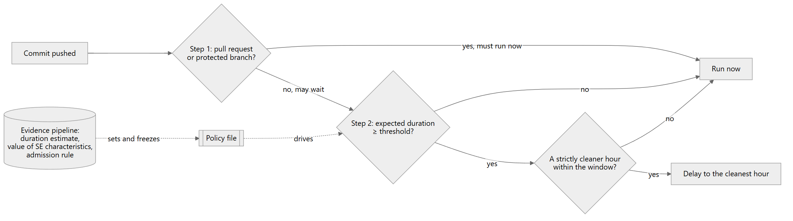

---

## 4.4 System Architecture

The system uses a **layered architecture with one shared decision core** (Figure 4.2). A single
library holds all decision logic. The replay simulator uses it for the evaluation, and the developer
integration uses it for live recommendations; neither has its own copy of the logic. This matters
because the evaluation is only meaningful if it tests exactly the logic that developers receive.

- **Data layer.** The historical CI dataset, the UK grid carbon-intensity series with its hour-of-week
  profile, and the locked record of which project belongs to which data set. These are read-only.
- **Evidence layer.** Offline steps that extract characteristics, split the data, estimate duration,
  train the models, measure added value, apply the admission rule and fit the policy. Each step saves
  its output so the next step loads it instead of re-creating it.
- **Core layer.** The eligibility rules, the decision function, the carbon lookup and, at run time,
  the frozen duration estimator. Energy and carbon accounting sits in this layer but outside the
  decision path: no decision module imports it, and every caller uses it only after the decision has
  been made. That separation is deliberate: it makes it impossible for a build's actual energy use to
  influence its own decision.
- **Evaluation layer.** The replay simulator and an independent safety checker.
- **Advisor layer.** The advisor validates the request, checks the team's settings and the declared
  region, and verifies the frozen files. It then reads the completed run history, estimates duration
  with the frozen estimator and calls the decision function. Finally it applies the team's vetoes,
  which can only turn a deferral into RUN NOW.
- **Presentation layer.** Thin adapters around the advisor, with no decision logic of their own: a
  command-line tool, a REST API, a GitHub Action that shows RUN NOW or DEFER RECOMMENDED in the CI run
  summary, and the What-If report.

**Figure 4.2 — Layered system architecture with a shared decision core**

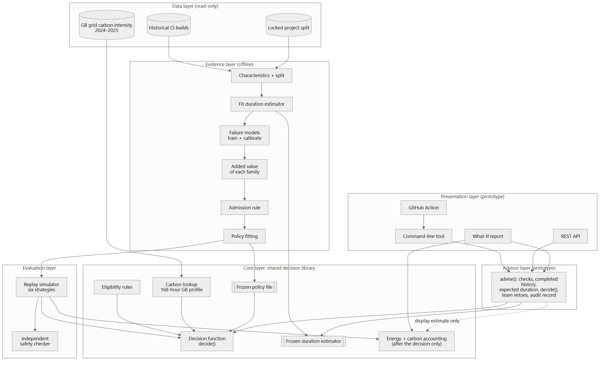

**Figure 4.3 — Deployment view of the prototype**

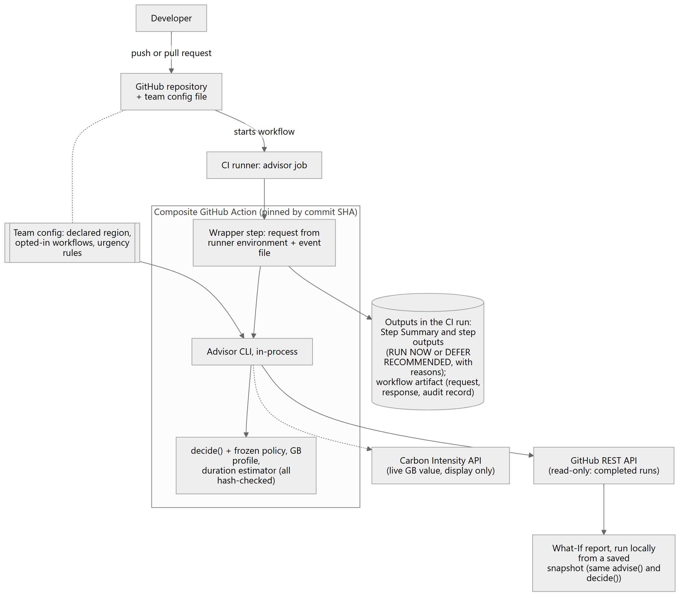

> The prototype is **decision support**: it recommends RUN NOW or DEFER RECOMMENDED, and the developer
> or team decides. It never pauses, cancels, re-schedules or fails a build, and its step always
> completes successfully. An optional workflow that would re-run a deferred build later was planned
> but cut, so acting on a recommendation is left to the team. If any input, check or service fails,
> the advisor answers RUN NOW and names the reason.
>
> The carbon data covers Great Britain only, so the team must declare where its builds run. The tool
> never detects the location, and any region other than GB gives RUN NOW. A workflow cannot choose or
> verify the region of a GitHub-hosted runner, so such a runner cannot honestly be declared to be in
> GB. In the demonstration repository the real runs were therefore declared `GITHUB-HOSTED` and
> received RUN NOW. The DEFER RECOMMENDED results shown were produced in an explicitly labelled
> *scenario* mode, which shows what the advisor would recommend if the build ran on GB compute.

---

## 4.5 System Design

This section explains each design diagram. Use-case, component, class, data-flow and sequence views
are used because, together, they show who uses the system, what it is made of, how data moves through
it, and in what order a live recommendation happens.

### 4.5.1 Use-case view

Figure 4.4 shows four actors. The **developer** pushes commits and reads the recommendation. The **CI
platform** runs the integration. The **researcher** runs the evidence pipeline and the replay. The
**grid data service** supplies carbon intensity. Nobody has to label builds as flexible by hand:
flexibility is inferred from how the build was triggered. A team may optionally mark extra branches or
commits as urgent, but such settings can only make a build run sooner, never later. That automatic
inference is the gap in existing carbon-aware CI tools that this work addresses. A **team
maintainer** declares where the team's builds run and which workflows are advised, and may shorten
the maximum delay below 24 hours. None of these settings can make the advisor defer a build that the
frozen policy would run now. The maintainer can also generate a What-If report for the repository.

**Figure 4.4 — Use-case diagram**

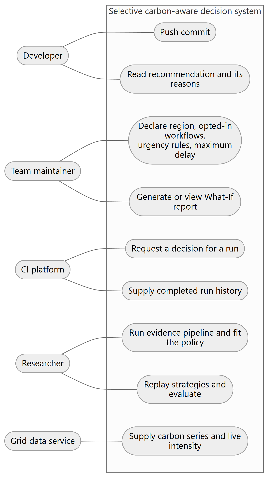

### 4.5.2 Component view

Figure 4.5 shows the main components and the dependencies allowed between them. Two design choices
matter most.

- **The eligibility check runs first and ends the decision** for any build that must run now; the
  second step is never consulted for such builds. An automated test proves this by withholding the
  second step's inputs entirely.
- **Accounting is kept apart from deciding.** The energy and carbon component does not depend on the
  decision components, and a test fails if any decision component ever depends on it. Actual energy
  use therefore cannot leak into a decision.

Arrows show which component uses or feeds which. The command-line tool, GitHub Action, REST API and
What-If report reach the decision function only through the advisor. The What-If report uses
accounting only after each decision has been made.

**Figure 4.5 — Component diagram**

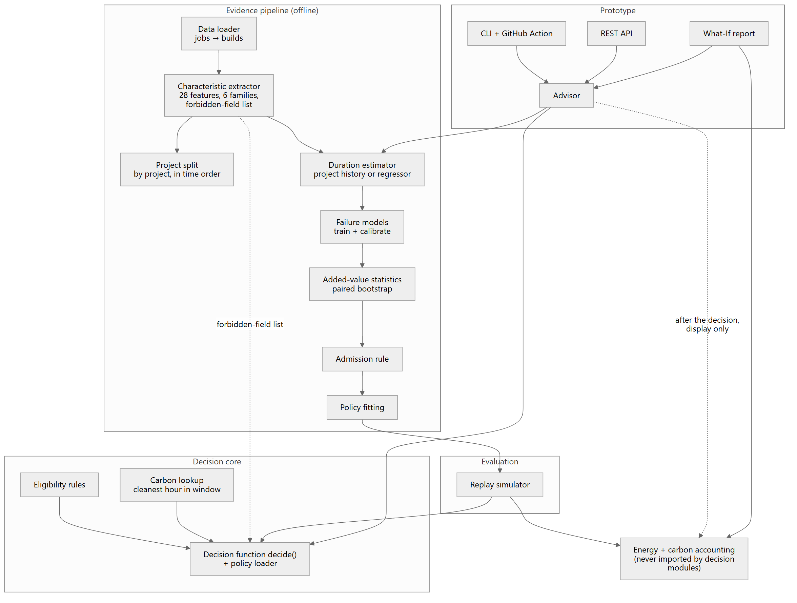

### 4.5.3 Class view of the decision contract

Figure 4.6 uses the names in the code. The decision function `decide()` receives three things:

- a build mapping that holds only commit-time values: the pull-request flag, the branch, the arrival
  weekday and hour, and the expected duration;
- the 168-hour carbon profile;
- a validated `PolicySpec`, loaded from a file with a *closed* format. Unknown settings are rejected,
  the source of every value must be recorded, and an unfitted draft policy is refused by default.

`Eligibility` is the step-1 verdict; `decide()` computes it internally and copies its rule into the
decision. A `DurationEstimate` is produced outside the function, and only its value in seconds is
passed in. `Decision` is what every caller receives. Its `defer_until` field is an offset in hours
from the arrival hour, plus the target weekday and hour, so the decision function never needs to read
a clock.

**Figure 4.6 — Class diagram of the decision contract**

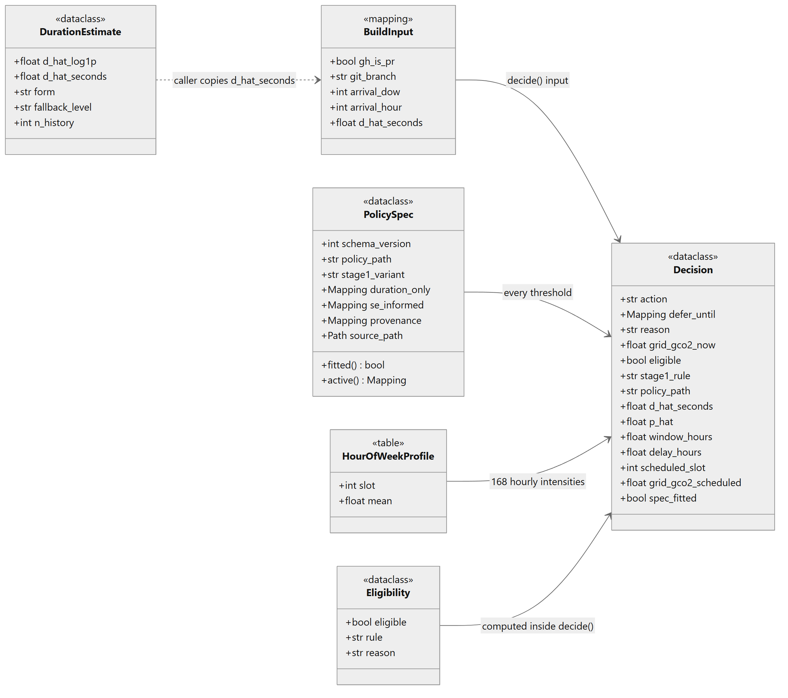

### 4.5.4 Data-flow view of the evidence pipeline

Figure 4.7 shows how data moves through the offline pipeline. Two properties hold throughout. The test
set is set aside, unread, until the final evaluation. And each stage loads the previous stage's saved
output rather than re-creating it. For example, the duration estimate is fitted once and then loaded
by every later stage, so the baseline cannot shift between experiments.

**Figure 4.7 — Level-1 data-flow diagram of the evidence pipeline**

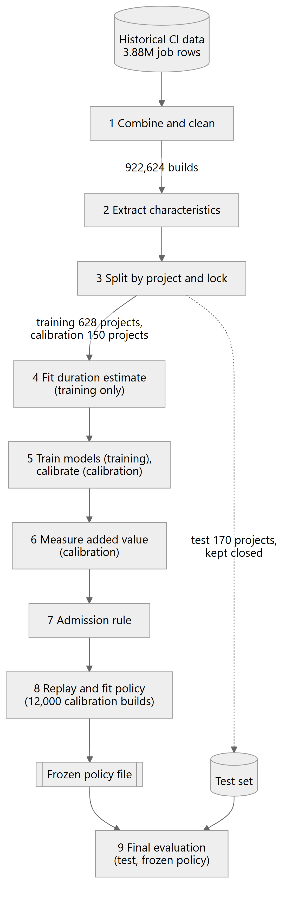

### 4.5.5 Sequence view of a live recommendation

Figure 4.8 shows the run-time interaction of the built GitHub Action.

- **Inputs.** The decision function receives only information available before the build runs; the
  build's own duration and outcome are rejected if supplied.
- **History.** Run history is read only when the eligibility rules say the build may wait.
- **Expected duration.** It is computed by the frozen research estimator from completed runs of the
  same workflow (successful or failed) that had **finished** before this run's arrival time. In the
  Action, the arrival time is the UTC clock at the advisor's first step. With no such history, the
  team's cold-start rule (on by default) gives RUN NOW.
- **Carbon data.** The decision uses the same Great Britain carbon profile as the evaluation. The
  live grid intensity is fetched afterwards and only displayed.
- **Safety.** Team settings can only turn a deferral into RUN NOW. If any check or service fails,
  the answer is RUN NOW, and the step never fails the pipeline.
- **Outputs.** The result appears in the run's Step Summary and step outputs. The request, response
  and audit record are uploaded as a workflow artifact.

**Figure 4.8 — Sequence diagram: live recommendation**

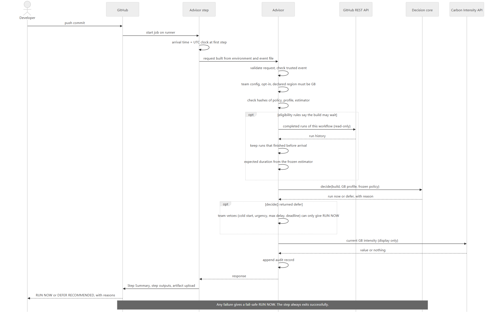

---

## 4.6 Algorithms / Models

### 4.6.1 Algorithm 1 — The two-step decision

The decision function is the centre of the solution. It works through five checks in order:

1. **Reject leaked information.** If the input contains the build's actual duration or outcome, the
   function refuses it with an error rather than ignoring it.
2. **Apply the eligibility rules.** A build that must run now is returned immediately with the rule
   that fired.
3. **Check whether waiting is worthwhile.** A build that may wait but is expected to be short (below
   the duration threshold) runs now, because delaying it would cost the full wait for almost no carbon
   saving.
4. **Find the cleanest hour.** For a longer build, the function looks for the lowest-carbon hour
   within the permitted window.
5. **Delay only if it helps.** The window is counted in whole hours, up to and including its end,
   and ties go to the earliest hour. A build is therefore delayed only when some hour in the window
   is strictly cleaner than now; otherwise it runs now.

The design also supports a variant where the window shrinks as the predicted failure risk rises:
window = maximum delay × (1 − failure probability). Risky builds would wait less, so their failure
would be reported sooner. This variant is used only if an SE family is admitted. The function contains
no numeric threshold of its own; every value comes from the policy file, and an automated check
confirms this.

**Figure 4.9 — Flowchart of Algorithm 1 (the decision function)**

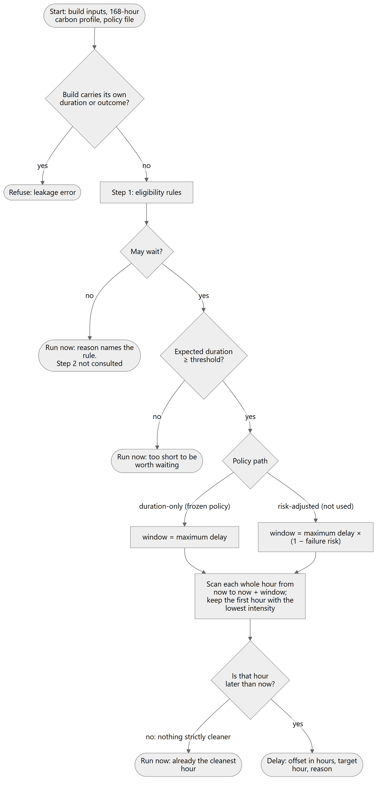

### 4.6.2 Algorithm 2 — Eligibility rules

The eligibility rules capture urgency, and they deliberately never use machine learning: failure risk
and urgency are different things. A small, low-risk change may still be urgent.

The dataset records only two usable trigger details: whether the build is for a pull request, and the
branch name. The rules are therefore an approximation of real urgency. A build may wait only if it is
**not** a pull-request build **and** its branch matches none of a fixed list of protected patterns:
main branch, production, release, stable, maintenance, hotfix, version tags, version series and
pre-release. The pull-request check comes first, so a pull request into the main branch counts as a
pull request. Anything that cannot be interpreted is treated as not delayable.

On the development data (783,931 builds), 191,245 builds (24.4%) could wait. A stricter variant that
also protects development-integration branches leaves 132,100 (16.9%), and it is used as a
sensitivity check.

A second checker, written independently with a different matching method, agreed with the rules on
all 55,228 distinct combinations of pull-request flag and branch name, with no disagreement. This
shows the rules are implemented consistently, but not that they are the right rules: the dataset has
no ground-truth record of which builds were truly urgent.

**Figure 4.10 — Flowchart of Algorithm 2 (eligibility rules)**

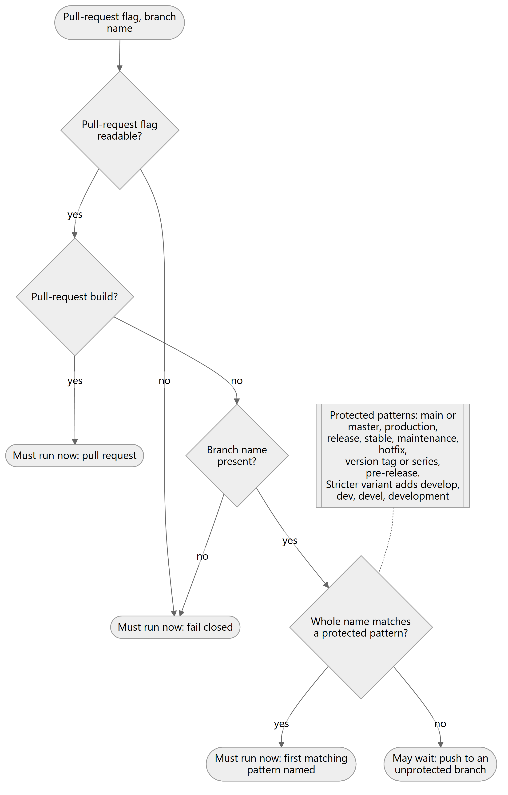

**Figure 4.11 — Chart: eligibility outcome for 783,931 development builds**

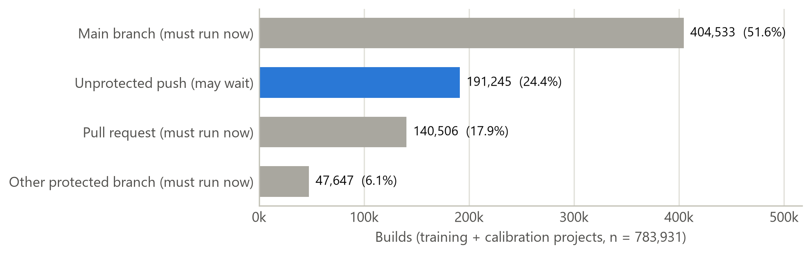

### 4.6.3 Model 1 — The expected-duration estimate (the baseline)

**What it is.** An estimate, made when the commit arrives, of how long the build will take. It is
modelled on the logarithm of duration because build durations are heavily skewed. Two forms were
specified before any code was written:

- **Project history.** The median duration of the same project's builds that had *finished* before
  this one arrived. Arrival is the build's start time, and builds without a recorded duration do not
  count. If a project has no such builds, the estimate falls back to the median duration for the
  programming language, and then to the overall median duration. Both fallbacks are computed from
  training data only.

  This rule was tightened during the project. An earlier version also counted builds that had
  started but not yet finished, which a real CI system could not know. The fix was logged, and every
  result was re-run with the corrected rule (Chapter 5).
- **Commit-characteristic regressor.** An XGBoost regression model that predicts duration from the 28
  commit characteristics, trained on training projects only.

**How it was chosen, and why.** The rule was fixed in advance: the form with the lower error on the
calibration set becomes the baseline, and a tie goes to the simpler form. The project-history form won
clearly. Its mean absolute error on the log scale was 0.602, against 1.178 for the regressor, and its
rank correlation with actual duration was 0.869 against 0.526. Rank quality matters most, because the
policy applies a threshold to the estimate.

The project-history form also suits deployment: a CI service already knows its own repository's build
history. And because it effectively encodes which project a build belongs to, it is a strict baseline
that any SE signal must beat.

A variant using only the last 50 finished builds scored better still (0.291). The chosen form was nevertheless
kept, because switching after seeing results would have undermined the pre-registration. The variant
is reported as a finding and tested as a sensitivity check.

**Figure 4.12 — Flowchart: expected duration from project history, with fallbacks**

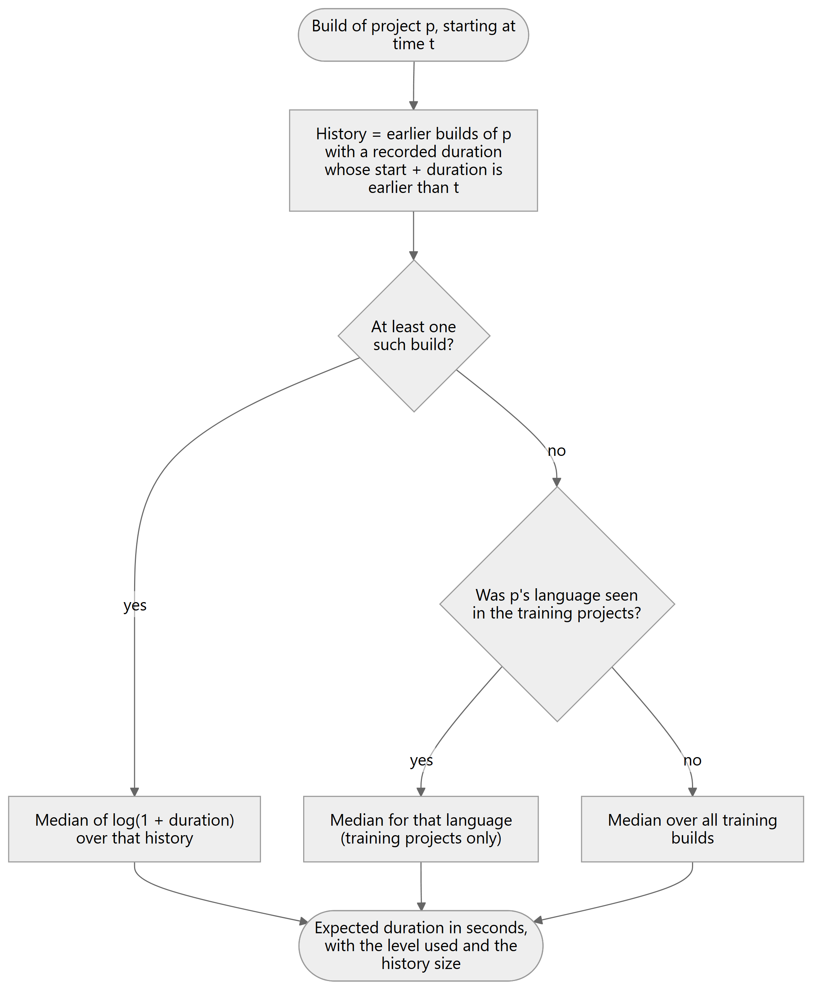

### 4.6.4 Model 2 — Calibrated failure-probability models (the candidate SE signal)

**What it is.** A classifier that predicts whether a build will fail, where failure means the build
ended as "failed" or "errored". Its output is a *calibrated* probability, meaning that, for example,
builds given a 30% risk fail about 30% of the time. This matters because the policy would use the
probability itself to set the window, not a yes/no label.

Three algorithms were trained:

- **XGBoost**, chosen in advance as the main model;
- **logistic regression**, as a simple, interpretable linear baseline;
- **random forest**, as a second tree-ensemble baseline.

Each algorithm was trained twice: once with the duration estimate alone (the *control*) and once with
the duration estimate plus all 28 commit characteristics (the *full* model). Six further XGBoost models
each add one family to the duration estimate, so that each family's added value can be measured on
its own.

**Why XGBoost.** The data is tabular, large (645,244 training builds) and imbalanced (about 24% of
builds fail). Gradient-boosted trees handle mixed-scale features, missing values and non-linear
effects natively, and they run quickly on a CPU (Chen & Guestrin, 2016). Tree models also allow
exact, efficient SHAP explanations (Lundberg & Lee, 2017), which the explainability requirement needs.
Deep learning and large language models were deliberately excluded: on tabular data of this kind they
add cost and reproducibility problems with no expected accuracy gain.

**How it was trained.** Settings were tuned only on the training projects, using the most recent 20%
of training builds as a time-ordered validation set. The tuning was a seeded random search of 20
candidates per model, identical across models. Models were selected by the area under the
precision–recall curve (PR-AUC), which is more informative than ROC-AUC when failures are the minority
class (Saito & Rehmsmeier, 2015). Class imbalance was handled by weighting the failure class.

Each model was then calibrated on the calibration set with two standard methods, isotonic regression
(Zadrozny & Elkan, 2002) and Platt scaling (Platt, 1999), and the one with the lower Brier score was
kept. Isotonic regression was chosen for every model.

**Development-stage evidence.** On the calibration set, adding the SE characteristics did not improve
on the duration estimate for any algorithm. For XGBoost, PR-AUC was 0.391 for the control and 0.311
for the full model. The held-out results are reported in Chapter 5.

### 4.6.5 Algorithm 3 — Measuring added value and the admission rule

For each family, the added value is the change in PR-AUC when that family is added to the duration
estimate. Its uncertainty comes from a **paired bootstrap** (Efron & Tibshirani, 1993):

- the calibration builds are resampled with replacement 1,000 times;
- both models are scored on the *same* resample each time;
- the middle 95% of the resulting differences forms the confidence interval.

A family is **admitted** into the policy only if two conditions hold, and both were fixed before any
result was seen.

1. **Model level.** The 95% confidence interval of its PR-AUC gain must lie entirely above zero, and
   the gain must be an improvement of at least 0.01.
2. **Decision level.** A policy using the family must beat **both** duration-only policies (regressor
   and project history), swept over the same grid. Their trade-off curves are compared at ten matched
   points on each axis.
   - **Size of the gain.** At equal carbon saving, the policy must cut the 95th-percentile feedback
     time for failing builds by at least 5%. Alternatively, at equal feedback time, it must reach a
     carbon saving at least 1% larger in relative terms (not one percentage point).
   - **Confidence.** The improvement's paired-bootstrap 95% interval must lie above zero.
   - **Count.** This must hold at three or more matched points on one axis. A point that cannot be
     evaluated in more than 5% of resamples does not count.

Every decision is repeated at half and at double both floors, to show how much the outcome depends on
where they were set. Because no family passed the model level, the decision-level test never had a
candidate.

**Figure 4.13 — Flowchart of Algorithm 3 (admission rule)**

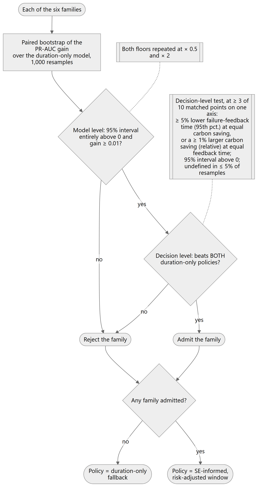

**Development-stage outcome.** All six families were rejected. Every family's PR-AUC change was
negative, with its whole confidence interval below zero (Table 4.4). None was admitted even at half
the threshold.

**Table 4.4 — Added value of each family over the duration estimate (calibration set)**

| Family | Change in PR-AUC | 95% confidence interval |
| :-- | --: | :-- |
| F1 Change size and spread | −0.0035 | −0.0052 to −0.0017 |
| F2 Change purpose and file mix | −0.0065 | −0.0081 to −0.0050 |
| F3 Test activity and maturity | −0.0331 | −0.0364 to −0.0297 |
| F4 Project history and maturity | −0.0665 | −0.0694 to −0.0633 |
| F5 Developer and team | −0.0729 | −0.0757 to −0.0697 |
| F6 Timing and trigger | −0.0084 | −0.0101 to −0.0068 |

**Figure 4.14 — Chart: added value per family with 95% confidence intervals**

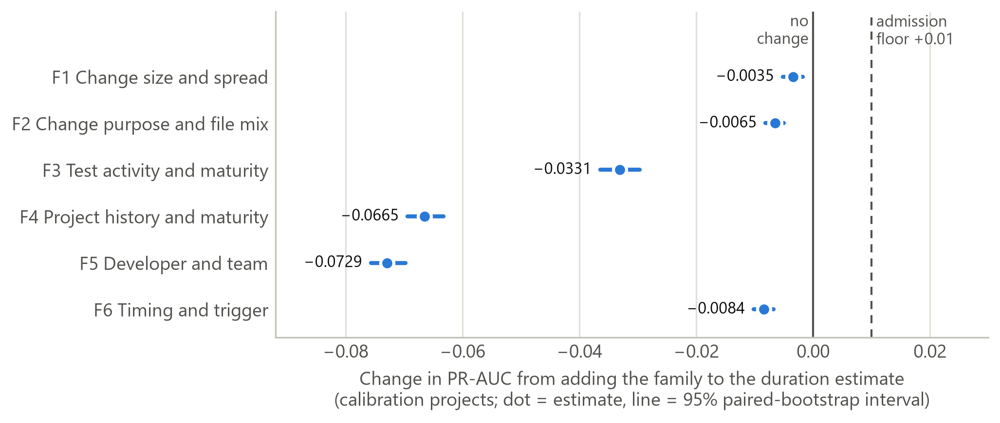

Figure 4.15 shows that a family can matter a great deal *inside* the full model and still add nothing
when tested on its own. Project history (F4) and test activity (F3) carry the largest SHAP
contributions, yet both made predictions worse in Table 4.4. Feature importance therefore cannot
replace the admission rule.

**Figure 4.15 — Chart: how much each family contributes inside the full model (SHAP)**

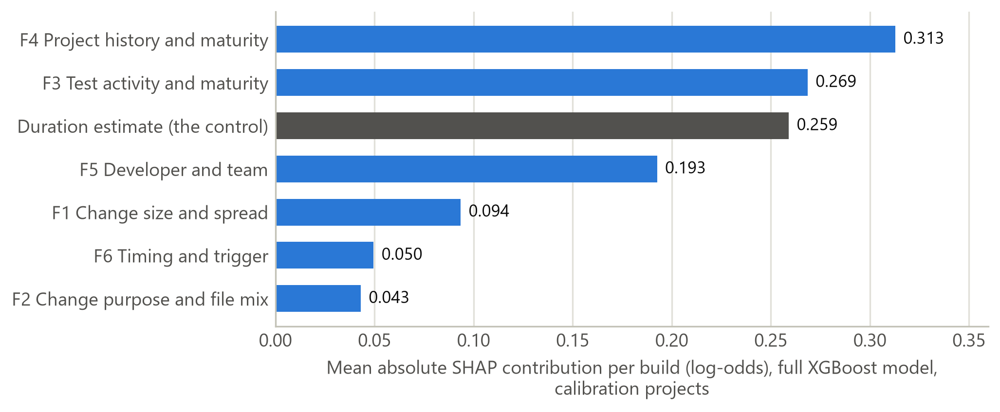

### 4.6.6 Algorithm 4 — Fitting the policy's thresholds

With no family admitted, the policy needs two numbers: the **duration threshold** and the **maximum
delay window**. They were chosen by replaying 12,000 calibration builds under the project-history
duration-only strategy, over a fixed grid of candidates set before any result was seen:

- duration thresholds of 0, 60, 120, 240, 480, 960, 1,920, 3,840, 7,680 and 15,360 seconds;
- windows of 6, 12 and 24 hours.

A **carbon-retention rule**, also fixed in advance, picked the operating point:

1. Find the largest carbon saving any grid point achieves (here 3.78%).
2. Keep the points that retain at least 90% of it.
3. Among those, choose the one with the lowest 95th-percentile feedback time for failing builds;
   ties go to the larger threshold, then the shorter window.

Five points qualified, all with a 24-hour window. The chosen point was **480 seconds and 24 hours**,
saving 3.48% of carbon on the development sample. Refitting from scratch reproduced the policy file
byte for byte.

**Figure 4.16 — Flowchart of Algorithm 4 (choosing the operating point)**

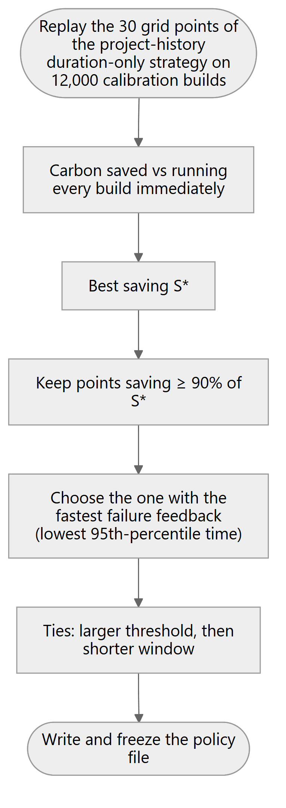

**Figure 4.17 — Chart: the development-stage trade-off (12,000 calibration builds)**

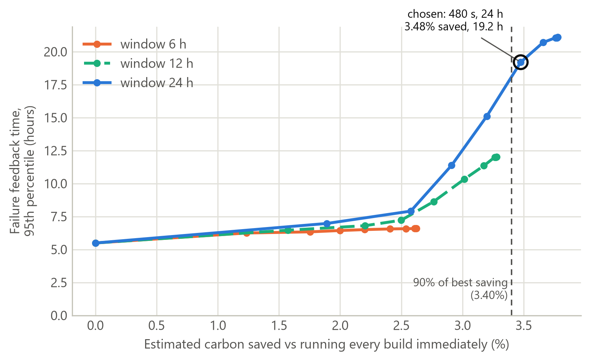

### 4.6.7 Algorithm 5 — The replay simulator

The simulator replays builds in the order they started, through six strategies, **on exactly the same
builds**:

1. **Static** — every build runs immediately, as CI does today.
2. **Blanket carbon-aware** — every build that may wait goes to the cleanest hour within the next 167
   hours (the whole weekly profile), whatever its duration.
3. **Eligibility-only** — every build that may wait goes to the cleanest hour within a fixed window of
   6, 12 or 24 hours, whatever its duration; this is duration-only with a zero threshold.
4. **Duration-only** — only longer builds are delayed, in two versions: one using the
   commit-characteristic regressor and one using project history.
5. **Proposed evidence-derived policy** — the frozen policy file. With no family admitted, it is
   identical to duration-only with project history.
6. **Risk-only skip** — builds that may wait and whose calibrated failure probability is below a
   threshold τ (0 to 0.30) are not run at all, so their failures go unreported. Builds that must run
   now are never skipped. This is a comparison from the build-skipping literature.

Strategies 2 to 5 call the same decision function. Strategy 1 runs everything immediately, and
strategy 6 applies the same eligibility rules before skipping. A build's actual duration is used only
*after* its decision is made, to account for energy and carbon:

- energy (kWh) = average power (42.5 W) × duration;
- carbon = energy × grid intensity at the hour the build actually runs.

The simulator reports carbon per 1,000 builds, carbon per successful commit, added delay, the time
until a failing build's result is known, failures missed by skipping, and a safety count. An
independent checker confirms the safety count is zero.

**Figure 4.18 — Flowchart of Algorithm 5 (replay loop)**

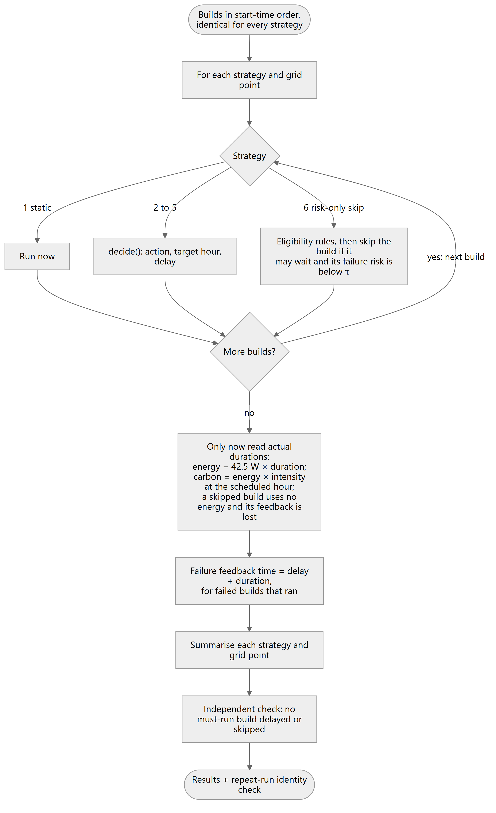

---

## 4.7 Data Sets / Data Preparation

**Primary dataset — TravisTorrent** (Beller et al., 2017). The 2017 release has one row per Travis CI
job, across 66 columns, and covers April 2011 to August 2016. It provides everything the study needs
in a single source: commit characteristics, build outcome, build duration and timestamps. The same
dataset is used both to train the models and to drive the replay. That avoids the mismatch that
arises when a model is trained on one dataset and applied to another with different fields.

**Secondary dataset — UK grid carbon intensity.** This comes from the National Grid ESO Carbon
Intensity API: the national hourly series for 2024 and 2025 (17,529 of 17,544 hours present; 99.8%
and 100% complete).
The build records are older than any freely available carbon data, so each build is matched to the
grid by **hour of the week**: its weekday and hour are given the average intensity of that hour across
the carbon series. This is a stated modelling assumption.

The weekly profile ranges from 92.2 g CO₂/kWh (Sunday 11:00) to 172.9 g CO₂/kWh (Wednesday 18:00).
Moving a build from the dirtiest to the cleanest hour could therefore cut its carbon by at most about
47%.

**Preparation steps.**

1. **Build level.** A build can consist of several jobs. Job rows are combined into one record per
   build, and the build's duration is taken as its longest job. This also keeps all of a build's jobs
   in the same data set.
2. **Cleaning.** Cancelled and unlabelled builds are removed (Table 4.5). No exact duplicates were
   found.
3. **Label.** A build is a failure if it ended as "failed" or "errored", and a pass if it "passed".
   The failure rate is 25.1%.
4. **Characteristics.** The 28 characteristics are grouped into six families (Table 4.6). Every field
   that is only known after a build finishes (its status, test results, duration) is on a forbidden
   list that is checked automatically.
5. **Split.** Whole projects are assigned to the training, calibration or test set, preserving time
   order (Table 4.7). The assignment is then locked with a checksum.
6. **Data-quality findings.**
   - The field recording changes to test code is empty in the entire release, so two
     characteristics carry no information.
   - Commit messages and change-entropy measures are not available, so some well-known predictors
     from the defect-prediction literature (Kamei et al., 2013) cannot be built.

   The SE side of the comparison is therefore a lower bound on what richer data could show.

**Table 4.5 — Cleaning steps**

| Step | Rows in | Rows out |
| :-- | --: | --: |
| Raw job rows | 3,881,992 | 3,881,992 |
| Remove exact duplicates | 3,881,992 | 3,881,992 |
| Combine jobs into builds | 3,881,992 | 925,897 |
| Remove builds with a missing or unusable label | 925,897 | 925,896 |
| Remove cancelled builds | 925,896 | 922,624 |
| Remove builds with a missing start time | 922,624 | **922,624** |

**Figure 4.19 — Chart: data-preparation funnel**

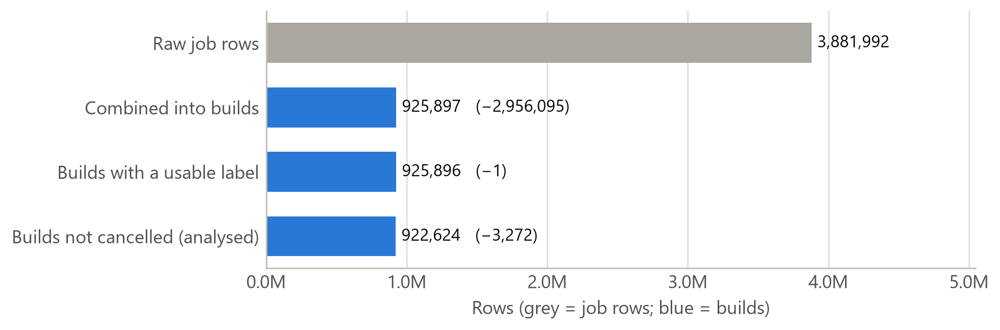

**Table 4.6 — Families of commit characteristics**

| Family | What it describes | Examples | Count |
| :-- | :-- | :-- | :-: |
| F1 | Change size and spread | lines of source changed, files added / modified / deleted | 7 |
| F2 | Change purpose and file mix | source vs documentation files, documentation-only change | 6 |
| F3 | Test activity and maturity | tests added, test lines and assertions per 1,000 lines | 5 |
| F4 | Project history and maturity | project size, age, number of commits, language | 5 |
| F5 | Developer and team | team size, whether the author is a core member | 2 |
| F6 | Timing and trigger | pull-request flag, hour of day, day of week | 3 |

**Table 4.7 — The three data sets**

| Set | Projects | Builds | Share | Failure rate | Used for |
| :-- | --: | --: | --: | --: | :-- |
| Training | 628 | 645,244 | 69.9% | 24.4% | fitting the duration estimate and training models |
| Calibration | 150 | 138,687 | 15.0% | 28.5% | calibrating models, measuring added value, fitting the policy |
| Test | 170 | 138,693 | 15.0% | 25.0% | the single final evaluation (Chapter 5) |

**Figure 4.20 — Chart: UK grid carbon intensity by hour of the week** *(outlined cells: the cleanest
hour, Sunday 11:00, and the dirtiest, Wednesday 18:00)*

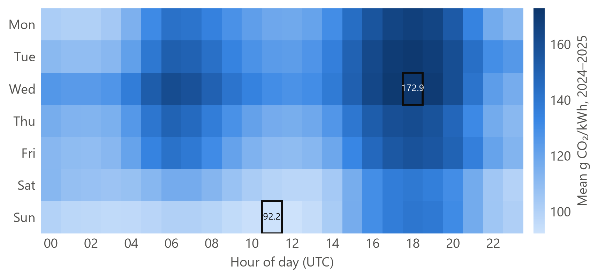

---

## 4.8 Technology Selection

**Table 4.8 — Technology selection and justification**

| Technology | Where it is used | Why it was chosen |
| :-- | :-- | :-- |
| **Python 3.11** | The whole solution: pipeline, decision library, simulator, integration | The standard language for data science. One language for research code and prototype makes a single shared decision library straightforward. |
| **pandas and NumPy** | Loading 3.88 million rows, combining jobs, building characteristics, replay records | Mature, fast table processing that runs on a single laptop. |
| **scikit-learn** (Pedregosa et al., 2011) | Logistic regression, random forest, calibration, pipelines, metrics | Well-tested standard implementations. Pipelines save preprocessing together with the model, so predictions cannot drift from training. |
| **XGBoost** (Chen & Guestrin, 2016) | Main failure model; duration regressor | Strong on imbalanced tabular data, handles missing values natively, fast on a CPU. |
| **SHAP** (Lundberg & Lee, 2017) | Explaining models by characteristic and by family | Consistent explanations with an exact, fast method for tree models. |
| **matplotlib** | All figures | Scriptable, so every figure is redrawn from saved results. |
| **YAML (safe loading only)** | The policy file | Human-readable and easy to compare between versions; safe loading prevents code execution. |
| **pytest** | Automated tests (807 at the time of writing) | Simple and flexible; the tests act as executable proof of the design rules. |
| **Carbon Intensity API (NESO, formerly National Grid ESO)** | Historical carbon series; current intensity shown in the prototype for information | Free, needs no key, openly licensed (CC BY 4.0), and covers Great Britain. |
| **CodeCarbon methodology** | The average-power figure of 42.5 W (an 85 W processor rating at 50% load) | A documented, citable default for a processor whose model is unknown. It is used as a configuration value, not as a running library. |
| **Green Software Foundation SCI** | Reporting carbon per successful commit | A standard, comparable metric. |
| **GitHub Actions** | The developer-facing integration *(prototype)* | A widely used CI platform, free for public repositories. Its job summary page gives a natural place to show a recommendation. |
| **GitHub REST API** | Reading a repository's completed run history *(prototype)* | Free; the token GitHub gives each workflow is enough, and it can filter for completed runs. |
| **FastAPI** | The REST API around the decision library *(prototype)* | Lightweight Python web framework with automatic request validation. |
| **Git and checksums** | Version control; locking the data split, policy file and candidate grid | Makes "fixed before results were seen" something that can be checked, not just claimed. |

Excluded on purpose:

- **Deep learning and large language models** — no expected benefit on this data, and costly to
  reproduce.
- **Hardware power meters** — they cannot be applied to historical builds.
- **Reinforcement learning** — outside the scope of this study.

---

## 4.9 Implementation

**Environment.** The solution runs on Windows 11 in a Python 3.11 virtual environment, with a pinned
list of 47 package versions (for example pandas 3.0, scikit-learn 1.9, XGBoost 3.2 and SHAP 0.51).
Everything runs on a single laptop CPU. The longest single step was the per-family analysis (about
66 minutes). Training the six failure models took about 40 minutes, and the one-off test-set
evaluation steps took 46–59 minutes each.

**Structure.**

- The decision library contains the data loader, characteristic extractor, data split, duration
  estimator, models, statistics, admission rule, eligibility rules, carbon lookup, accounting and the
  decision function.
- The simulator and the independent safety checker are separate components.
- The prototype adds an advisor package (request validation, team settings, run history, vetoes and
  audit), a REST API, a composite GitHub Action and the What-If report. All of them import the
  decision library rather than copying it.
- Each pipeline stage has one command that reproduces it, and each saves its outputs with a run log.

**How correctness is checked.** Quality is judged by evidence that nothing leaked and that runs
repeat exactly, not by a single accuracy number.

- **Tests.** 807 automated tests pass. They include:
  - tests that forbidden fields are rejected;
  - tests that the duration estimate only uses earlier builds that had already finished;
  - a test showing the decision function sees only permitted inputs;
  - a test showing that scrambling durations and outcomes changes no decision;
  - parity tests showing that the advisor, the command-line tool and the REST API return identical
    decisions, and that these equal the research decision function's own.
- **Safety.** The independent checker found no must-run build delayed across all replay records.
- **Reproducibility.** The replay and the policy fitting were repeated from scratch, and they
  produced identical files.
- **Controlled evaluation.** The test set was first opened only after the policy was frozen. Before
  that, the evaluation code had to reproduce every earlier development result exactly. It was opened
  a second time for one reason: to re-run the evaluation after the duration-history correction, under
  rules written down before any corrected result existed. The policy itself did not change.

**How the models and policy are evaluated.** Failure prediction is judged by PR-AUC and ROC-AUC, and
calibration by the Brier score and expected calibration error. Each family's value is measured as a
paired-bootstrap change in PR-AUC, and the duration estimate by its absolute error and rank
correlation. Scheduling strategies are compared by carbon saved and by the time until a failing build
reports its result, across a whole range of settings rather than at one point. The results are
reported in Chapter 5.

**Table 4.9 — Implementation status at the time of writing**

| Component | Status |
| :-- | :-- |
| Data preparation, carbon data, evaluation rules | Complete |
| Characteristics, data split, duration estimate, models, added-value analysis, admission rule | Complete |
| Eligibility rules, accounting, decision function, simulator, frozen policy | Complete |
| Final evaluation on the test set, including sensitivity analyses and the summary | Complete (re-run after the duration-history correction) |
| Advisor core, command-line tool and REST API | Complete (parity-tested against the research decision function) |
| GitHub Action and demo repository | Complete (seven real CI runs; the independent checker found 0 violations) |
| What-If report | Complete (five repositories; every report regenerates byte for byte) |

**Figure 4.21 — Screenshot: a RUN NOW recommendation in a GitHub Actions run (protected branch)**
*[Screenshot to insert: the Step Summary of the "advisor (GB scenario)" job in demo run 37734618114,
https://github.com/senith02/carbon-advisor-demo/actions/runs/37734618114/job/113171231712]*

**Figure 4.22 — Screenshot: a DEFER RECOMMENDED result for a delayable build, showing the expected
duration, the delay window, the estimated carbon change and the reason** *(GB scenario mode)*
*[Screenshot to insert: the Step Summary of the "advisor (GB scenario)" job in demo run 37735372444,
https://github.com/senith02/carbon-advisor-demo/actions/runs/37735372444/job/113173580637]*

**Figure 4.23 — The What-If report for the demonstration repository (rendered from the saved report)**

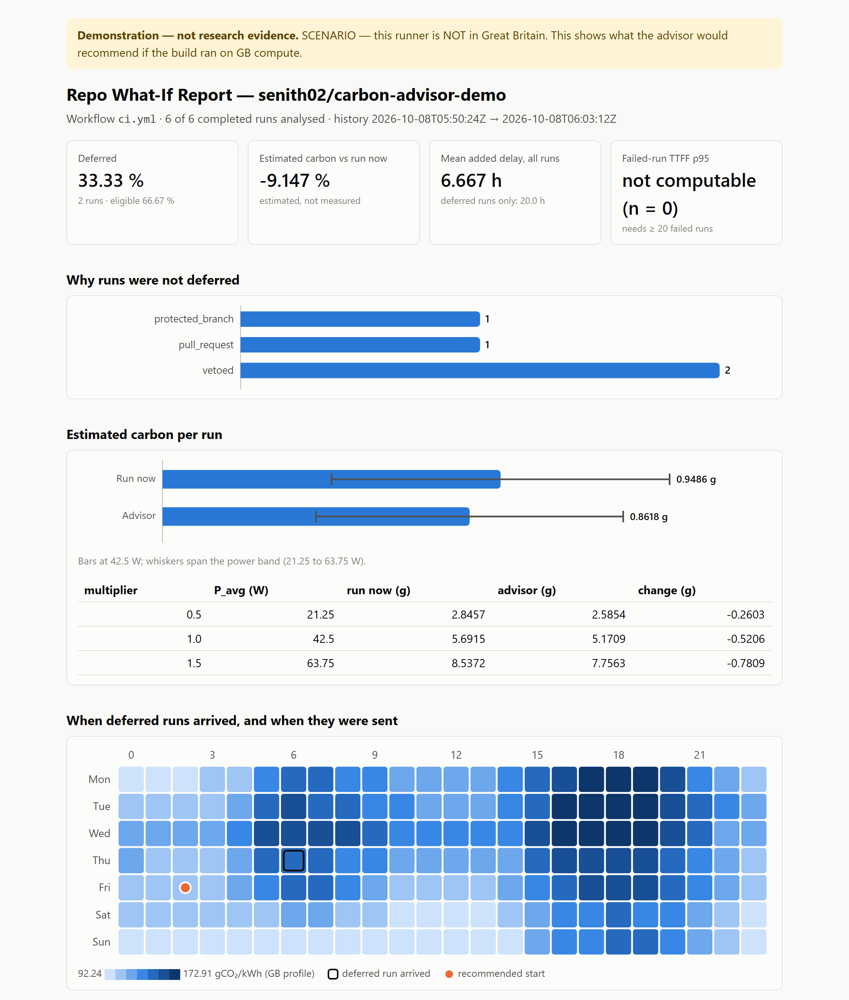

---

## 4.10 Chapter Summary

This chapter presented the proposed solution: an empirical decision system for **selective**
carbon-aware CI scheduling.

- **Requirements.** They were derived from the research questions and the evaluation plan. Freedom
  from information leakage, reproducibility, traceability and safety are treated as first-class
  requirements.
- **Architecture.** All decision logic sits in one shared library, used unchanged by the replay
  simulator and the developer-facing integration.
- **Design.** The design separates *whether a build may wait*, answered by fixed trigger rules, from
  *whether it is worth waiting*, answered by an evidence-derived policy. It keeps energy accounting
  away from decisions. And it tests SE characteristics against a strong duration estimate rather than
  against nothing.

On the development data, no family of SE characteristics met the admission rule, so the frozen
policy is duration-only: delay builds expected to take at least 480 seconds, to the cleanest hour
within 24 hours. The same frozen policy runs, unchanged, inside a GitHub Action, a REST API and a
What-If report. Chapter 5 reports how this policy and the alternatives performed on the 170 projects
held back for the final evaluation, and how the prototype behaved in real CI runs.

---

## References (APA 7th)

Beller, M., Gousios, G., & Zaidman, A. (2017). TravisTorrent: Synthesizing Travis CI and GitHub for
full-stack research on continuous integration. In *Proceedings of the 14th International Conference on
Mining Software Repositories* (pp. 447–450). IEEE. https://doi.org/10.1109/MSR.2017.24

Chen, T., & Guestrin, C. (2016). XGBoost: A scalable tree boosting system. In *Proceedings of the 22nd
ACM SIGKDD International Conference on Knowledge Discovery and Data Mining* (pp. 785–794). ACM.
https://doi.org/10.1145/2939672.2939785

Claßen, et al. (2023). *Carbon-awareness in CI/CD*.
https://www.researchgate.net/publication/379003736_Carbon-Awareness_in_CICD
*[Complete the author list and venue before submission.]*

CodeCarbon. (n.d.). *Methodology — CPU power estimation*. Retrieved from
https://docs.codecarbon.io/latest/explanation/methodology/

Efron, B., & Tibshirani, R. J. (1993). *An introduction to the bootstrap*. Chapman & Hall.

Green Software Foundation. (n.d.). *Software Carbon Intensity (SCI) specification*.
https://sci.greensoftware.foundation/

Kamei, Y., Shihab, E., Adams, B., Hassan, A. E., Mockus, A., Sinha, A., & Ubayashi, N. (2013). A
large-scale empirical study of just-in-time quality assurance. *IEEE Transactions on Software
Engineering, 39*(6), 757–773. https://doi.org/10.1109/TSE.2012.70

Lundberg, S. M., & Lee, S.-I. (2017). A unified approach to interpreting model predictions. In
*Advances in Neural Information Processing Systems 30* (pp. 4765–4774). Curran Associates.

Mhalla, A., & Saied, M. (2024). *Detecting continuous integration skip: A reinforcement learning-based
approach* [Preprint]. arXiv. https://arxiv.org/html/2405.09657v1

National Energy System Operator. (n.d.). *Carbon Intensity API* (formerly operated by National Grid
ESO). https://carbonintensity.org.uk/

Pedregosa, F., Varoquaux, G., Gramfort, A., Michel, V., Thirion, B., Grisel, O., Blondel, M.,
Prettenhofer, P., Weiss, R., Dubourg, V., Vanderplas, J., Passos, A., Cournapeau, D., Brucher, M.,
Perrot, M., & Duchesnay, É. (2011). Scikit-learn: Machine learning in Python. *Journal of Machine
Learning Research, 12*, 2825–2830.

Platt, J. C. (1999). Probabilistic outputs for support vector machines and comparisons to regularized
likelihood methods. In A. J. Smola, P. Bartlett, B. Schölkopf, & D. Schuurmans (Eds.), *Advances in
large margin classifiers* (pp. 61–74). MIT Press.

Saavedra, N., Mendes, A., & Ferreira, J. F. (2025). *Environmental impact of CI/CD pipelines*
[Preprint]. arXiv. https://arxiv.org/abs/2510.26413

Saito, T., & Rehmsmeier, M. (2015). The precision-recall plot is more informative than the ROC plot
when evaluating binary classifiers on imbalanced datasets. *PLOS ONE, 10*(3), e0118432.
https://doi.org/10.1371/journal.pone.0118432

Zadrozny, B., & Elkan, C. (2002). Transforming classifier scores into accurate multiclass probability
estimates. In *Proceedings of the 8th ACM SIGKDD International Conference on Knowledge Discovery and
Data Mining* (pp. 694–699). ACM. https://doi.org/10.1145/775047.775151

---

## List of figures and tables

Every figure is in `dissertation/figures/` as a 300-dpi PNG (for Word: Insert → Pictures) and an SVG
(editable vector). Diagram sources are in `figures/src/`; charts are drawn from the results files by
`code/scripts/make_dissertation_figures.py`.

| No. | Title | Type | File |
| :-- | :-- | :-- | :-- |
| Figure 4.1 | Solution overview: from commit to scheduling decision | Conceptual flow | `fig4_01_solution_overview` |
| Figure 4.2 | Layered system architecture with a shared decision core | Architecture | `fig4_02_architecture` |
| Figure 4.3 | Deployment view of the prototype | Deployment | `fig4_03_deployment` |
| Figure 4.4 | Use-case diagram | Use case | `fig4_04_use_cases` |
| Figure 4.5 | Component diagram | Component | `fig4_05_components` |
| Figure 4.6 | Class diagram of the decision contract | UML class | `fig4_06_class_diagram` |
| Figure 4.7 | Level-1 data-flow diagram of the evidence pipeline | Data-flow diagram | `fig4_07_data_flow` |
| Figure 4.8 | Sequence diagram: live recommendation | UML sequence | `fig4_08_sequence` |
| Figure 4.9 | Flowchart of Algorithm 1 (the decision function) | Flowchart | `fig4_09_decide_flowchart` |
| Figure 4.10 | Flowchart of Algorithm 2 (eligibility rules) | Flowchart | `fig4_10_eligibility_flowchart` |
| Figure 4.11 | Eligibility outcome for 783,931 development builds | Bar chart | `fig4_11_eligibility_outcomes` |
| Figure 4.12 | Expected duration from project history, with fallbacks | Flowchart | `fig4_12_duration_estimate` |
| Figure 4.13 | Flowchart of Algorithm 3 (admission rule) | Flowchart | `fig4_13_admission_rule` |
| Figure 4.14 | Added value per family with 95% confidence intervals | Dot-and-whisker chart | `fig4_14_family_added_value` |
| Figure 4.15 | How much each family contributes inside the full model (SHAP) | Bar chart | `fig4_15_shap_by_family` |
| Figure 4.16 | Flowchart of Algorithm 4 (choosing the operating point) | Flowchart | `fig4_16_policy_fitting` |
| Figure 4.17 | The development-stage trade-off | Line chart | `fig4_17_development_tradeoff` |
| Figure 4.18 | Flowchart of Algorithm 5 (replay loop) | Flowchart | `fig4_18_replay_loop` |
| Figure 4.19 | Data-preparation funnel | Bar chart | `fig4_19_data_preparation_funnel` |
| Figure 4.20 | UK grid carbon intensity by hour of the week | Heatmap | `fig4_20_carbon_hour_of_week` |
| Figures 4.21–4.22 | Recommendation summaries in GitHub Actions | Screenshots (to capture from the demo runs) | — |
| Figure 4.23 | What-If report for the demonstration repository | Screenshot | `fig4_23_whatif_report_demo` (PNG only) |
| Tables 4.1–4.9 | Requirements, input–process–output, added value, cleaning, families, data sets, technologies, status | Tables | — |
